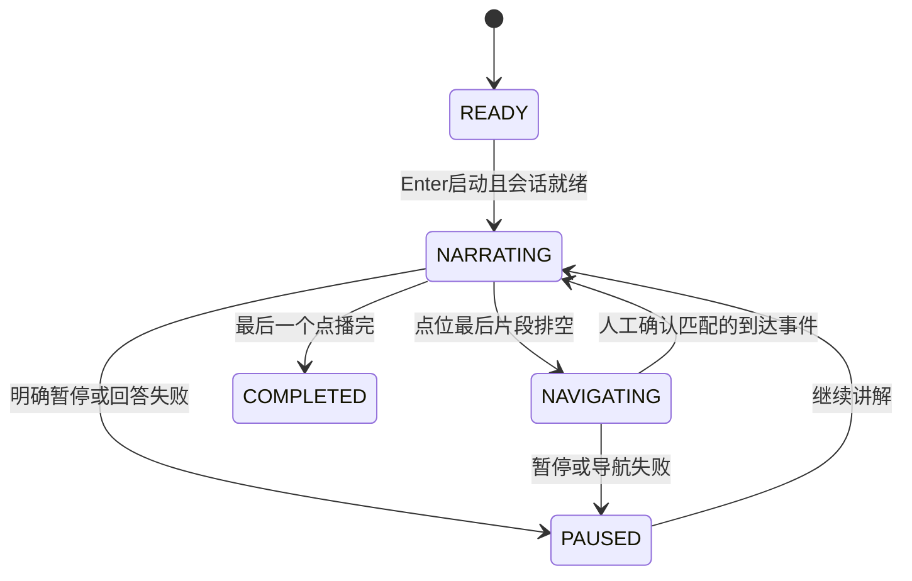

# 语音交互与导览服务

唯一启动入口仍为 `main.py`。不加 `--service` 会显示业务选择菜单；选好后仍需按 Enter 才启用麦克风和扬声器。空行 Enter 停止会话。

```bash
conda activate GuideBot
python main.py --service conversation
python main.py --service tour
```

语音交互读取 `developer/conversation/prompt.md` 及其知识库。导览读取 `developer/tour/prompt.md` 和 `context_template.md`，不叠加自由对话人设或其云知识库。

## 配置与离线准备

- `developer/tour/points.json`：讲解点 `id/name/script`，数组顺序就是讲解顺序。当前保留用户编辑的宇树 G1 点位。
- `prompt.md`：导览问答要求，全部可见。
- `context_template.md`：实际发送模型的点位、已讲片段和未完成片段模板，全部可见。
- `speech.json`：TTS 模型、音色、语速、WAV/24kHz及分段长度。默认 `stepaudio-3-tts`、`jingdiannvsheng`、每段最多180字符。

先检查，再生成：

```bash
python test/tools/tour/prepare.py --dry-run
python test/tools/tour/prepare.py
python test/tools/guidebot_preflight.py --service tour
python main.py --service tour
```

`--dry-run` 不读取密钥、不联网、不写资产、不启动设备。实际准备命令使用 `STEP_SECRET` 调用 StepFun TTS，上传讲解文本并生成音频；不会播放。修改讲解词、顺序或音色后须重新准备，运行时不默默使用过期版本。

每个片段按文本/模型/音色/参数/切分版本缓存。重试会复用已成功片段，仅完整成功后发布新bundle；运行中冻结使用同一版本。wav必须是24kHz单声道PCM16，加载时校验音频摘要。若已发布bundle损坏，预检拒绝启动；可移走对应bundle目录后重新准备，保留cache可避免再次合成。

数据位置：

```text
~/.local/share/guidebot/tours/
  cache/<segment_hash>.wav
  bundles/<bundle_id>/
    manifest.json
    audio/<segment_hash>.wav
~/.local/state/guidebot/ros2/foxy-*/session/
  tour-events.jsonl
  tour-checkpoint.json
  events.jsonl
  result.json
```

资产根目录支持 `XDG_DATA_HOME`；会话日志沿用现有ROS托管目录。导览检查点用于定位进度与问题，目前不自动跨进程续播，重启从首点开始。音频、凭据与同步状态均不进入Git。

## 运行和状态机

状态机在 `GuideBot/tour/controller.py`，不直接执行HTTP、文件读取或硬件操作；`session.py` 负责事件消费与调用适配器，`navigation.py` 是人工导航适配器。



交互状态独立为 `LISTENING / INTERRUPT_PENDING / ANSWERING`。播放讲解时仍持续上传麦克风，LocalVQE与AGC设置沿用正式前端。讲解和回答共用播放器和AEC参考，不同时播放两条声音。

候选人声 speech_started 时继续当前播放，与语音对话服务一致。只有云端 speech_interrupted 确认打断才停止输出，麦克风继续上传。未经确认的云端回答不进入播放；候选超时或 backchannel 不停止或重播讲解。确认后模型结合当前点位上下文回答；确认后长时间无回答、回答为空或失败则暂停，等待人工处理。离线本地讲解能否收到云端确认事件仍需实机验收，不使用候选事件兜底打断。

保存当前片段游标，最新回答的云端生成与本地播放均完成后，从被打断片段开头续讲，不重播整点。重复插话会丢弃旧回答；旧播放完成与旧到达事件不能推进新状态。

当前上下文包含当前点的完整讲解词，以及其它点的名称。不会自动把其它点全文或自由对话知识库塞给模型；跨点事实不足时应明确无法确认。问答准确性仍需实际场景验收。

## 人工到达和暂停

当前没有真实导航动作。首点假设机器人已就位；当前点播完后显示下一点，等待在同一终端输入：

```text
status
arrived 下一个点的ID
pause
resume
```

例如目标ID为 `point_1` 时输入 `arrived point_1`。可加任务ID做额外校验：`arrived point_1 nav-...`。未等待该目标时确认会被拒绝，不会自动跳点。

这些命令按 Enter 提交，只有空行 Enter 才退出。问答期间确认到达会先记录到达，回答排空后才讲下一点。当前只有一个注册点，播完进入COMPLETED，仍可提问，空行Enter退出。

也支持完整、明确的口头指令：`暂停`、`暂停讲解`、`停一下`、`不要说了`、`停止讲解`，以及 `继续`、`继续讲解`、`接着讲`。程序根据最终转写的整句匹配，不把“不要暂停讲解”误当作暂停。未列出的措辞由模型回答，但不保证改变本地流程；终端控制可作为确定入口。

## 当前边界

- 首版导览只使用语音；`--gestures`、`--gesture-backend`、`--timestamps`、`--sync-knowledge` 与tour不兼容，会在资源启动前拒绝。不启动动作LLM、上肢或底盘。
- 本地讲解离线播放，云端TTS准备和实时问答仍需联网；Realtime断线沿用已有会话失败清理机制，需要重新启动。
- 现有SDK没有设备播放结束回执，控制器使用 `playback.drained_estimated`。`response.done` 不能替代播放排空。不能承诺字级续播；长句超过分段上限时从当前片段开头续播。
- 当前导航只等人工到达。真实底盘接入前，须独立验证排空误差、导航策略和到达回执。
- 导览固定200ms播放提交块以改善打断粒度；这是提交块长度，不是已实测的打断时延。`--voice` 只覆盖在线问答音色；离线音色由speech.json决定，修改后重新准备。
- 所有运行所需静态提示词和上下文模板在用户目录；后台不附加隐藏角色或流程提示词。

## 验证记录（2026-11-26）

- 离线软件测试覆盖分段、缓存、合成失败重试、原子发布、改稿失效、音频损坏、双服务入口、句首续讲、重复插话、生成/播放结束乱序、问答期间到达、暂停与事件隔离。
- 实际使用StepFun TTS生成当前1个点的4个片段，合计30.48秒；WAV参数和摘要校验通过。第二次dry-run应显示to_generate=0。
- 实际建立无音频输入的Realtime会话，服务端确认 `stepaudio-3-realtime-preview / cixingnansheng / server_vad`，未绑定检索知识库。此检查不证明实际ASR、回声抑制或插话效果。
- 未启动麦克风、扬声器、DDS连接或运动，未做真机听感与打断时延测试。

人工验收顺序：启动tour并按Enter → 首段讲解时提问 → 确认只有一个回答音源 → 回答结束后从当前片段开头续讲 → 尝试“暂停讲解”和“继续讲解” → 添加第二点并重新准备后确认必须人工到达才开始下一点 → 空行Enter退出。

## 官方接口依据

2026-11-26读取：

- [StepFun TTS接口](https://platform.stepfun.com/docs/zh/api-reference/audio/create-audio)：`POST /v1/audio/speech`，单次input最多1000字符，支持WAV和24000Hz。`stepaudio-3-tts` 中英文括号 `()` 内容被作为指令、不发音，编写讲解词时注意其官方约定。
- [官方音色查询](https://platform.stepfun.com/docs/zh/api-reference/audio/system-voices)：支持按模型查询，示例列出 `cixingnansheng`。
- [Realtime接口](https://platform.stepfun.com/docs/zh/api-reference/realtime/chat)：session.update instructions、server_vad、response.cancel及转写事件。
- [Realtime指南](https://platform.stepfun.com/docs/zh/guides/developer/realtime)：server VAD自动响应，生成结束和播放完成应分别处理。


## 启动后立即停止问题的修复（2026-11-26）

ROS管理器除了检查资源worker，还会检查 `host.sock` 心跳端点。导览最初未创建该端点，导致首次巡检就关闭会话；日志中的 `server_vad` 实际是清理时的默认标签，并不代表用户插话。

当前VoiceWorker在启动tour前创建独立 `HostLifecycleEndpoint`，只提供带session/generation校验的生命周期接口，拒绝动作执行，不初始化动作LLM或运动SDK。退出清理会释放端点。ROS记录健康检查失败的具体环节；重复停止保持幂等，暂时忙碌时会重试，清理错误不再覆盖主错误。

离线真ROS验收（内部本机回环DDS；假语音、无云调用或机器人DDS）：

```bash
python test/integration/ros2/tour_lifecycle_acceptance.py
python test/integration/ros2/tour_lifecycle_acceptance.py --fail-host
```

前者检查连续健康巡检、状态查询和重复停止；后者故意关闭host端点，检查会话仍会被正确判为fault并停止。对应证据见 `test/experiments/reports/tour-voice-20261126/host-lifecycle-fix.json`。设备音频仍需用户按Enter验收。
