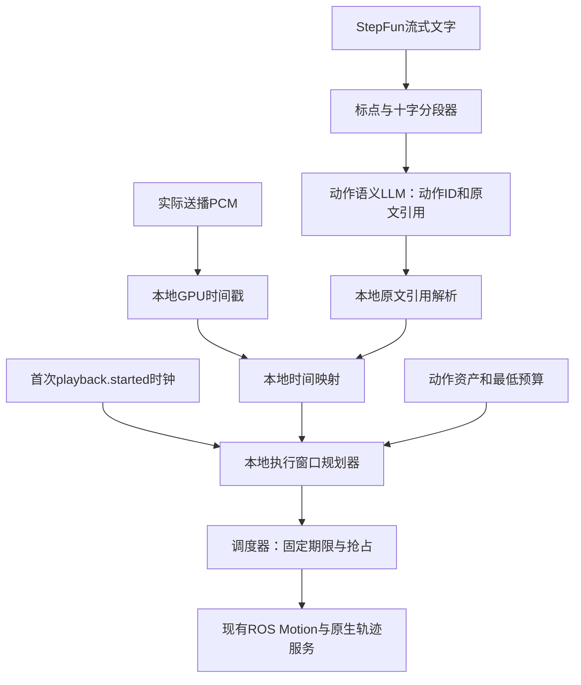

# 文本动作意图 → 本地时间映射 → 执行规划：协议修改方案

日期：2026-11-25。基线4a82714，**设计草案，尚未修改运行协议或接入Qwen**。本方案优先于前面的“LLM输出秒数”候选；保留用户已接受的固定期限、制动抢占、过期丢弃和Enter启动要求。

## 1. 职责与主数据流

按前述共识，LLM仍选择动作ID并对齐原文片段，但不负责音频时间、动作时长、最低预算、运动轨迹或调度；“文本对齐”不是让语言模型推理音频。



LLM与时间戳两个分支并行。拿到完整LLM回复即可继续下一段；不用等上一动作的时间戳、轨迹完成或播放结束。原始文字、单元表、回复ID和实际执行历史保存在本地。

初版保持既有ROS节点划分，只在Gesture节点内部拆出清晰的库接口，不增加TextBinder/WindowPlanner等独立网络服务。llama-server仍是独立原生模型进程；DeepSeek可以在同一新语义协议下做显式对照。

## 2. LLM输入：固定system + 当前一段原文

每次请求的消息内容只包含：

```json
[
  {"role":"system","content":"固定动作语义表、原文引用规则、JSON输出契约"},
  {"role":"user","content":"接下来请您看看左侧展出的园区沙盘。"}
]
```

system由已启用Catalog生成简短动作ID、用途/禁用语义与输出规范，保留不能编造物理能力、无需动作返回空等规则。删除旧units/eligible说明、旧duration、秒数、minimum_remaining_s和资产实现元数据；这些属于本地执行职责。当前十种动作在去除duration_s后没有需要LLM填写的其他参数；若未来加入依赖场景目标或参数的新动作，需另行扩展协议，不能让模型猜目标或能力。

user是原文字符串，保留标点与空白，不再逐字JSON展开。**不发送**playback_elapsed_s、playback_started、response_id、unit_id、text_offset、eligible清单、timing_contract、完整动作历史或空场景字段。每次只发尚未发送的新段，不发累计全文。

初版每段独立：没有隐式多轮记忆，也不默认拼接历史messages。全回复配额、源文字映射和执行状态由本地负责；仅当前段可能损失跨段语义，需回放专门评估否定/引用/前文依赖，不能宣称本地去重即可恢复语义上下文。若质量确实需要上下文，再单独比较“上一段只读背景”等方案，不悄悄恢复完整历史。

固定prompt在配置上只维护一份；普通chat API每次仍携带system。llama.cpp缓存固定前缀减少重复计算，不代表省略system后还能自动记住规则，也不代表历史token不计上下文。

## 3. LLM输出：动作ID + 两个原文引用

示例对应上面的输入：

```json
{
  "actions": [
    {
      "action": "present_left",
      "begin": {"text": "接下来", "occurrence": 1},
      "finish_by": {"text": "园区沙盘", "occurrence": 1}
    }
  ]
}
```

| 字段 | 精确定义 |
| --- | --- |
| action | 已启用动作ID，只负责语义选择 |
| begin | 引用当前段中的自然前导语；该引用首个文字单元的起始时间是允许开始动作的时刻 |
| finish_by | 引用当前段中的目标词；**该引用首个文字单元开始发音时，整个动作指令轨迹应已完成** |
| text | 必须逐字等于本次输入的一段连续原文，不改写、不补词 |
| occurrence | 此引用在当前段中第几次出现，从1开始；所有匹配起点按Unicode字符串偏移递增排列，包含重叠匹配 |

例如finish_by为“园区沙盘”，含义是说到“园”时应已完成，而不是说完整个“沙盘”才结束。这是文本锚点含义，LLM不输出秒数。动态动作的录制核心也必须在该点前完成；静态pose到位后可以保持到下一动作/倾听复位。

引用局限于当前段，begin必须位于finish_by之前；不得取相同起点构造零窗口。没有合适前导语、没有自然动作或无法可靠对齐时允许 `{"actions":[]}`，不要求每段都有动作。两处引用不要求模型数汉字或猜全局单元ID。

初稿结构见[JSON Schema](semantic-action-output-v1.schema.json)。其中enum是当前Catalog快照，运行时应从实际启用动作生成；schema不能验证原文匹配、先后顺序、真实时间或轨迹可行性，这些必须本地验证。初版禁止额外字段、duration_s、start_s/end_s、解释、思考块和Markdown；所有输出收齐、严格JSON校验后才产生意图，不接受半个SSE动作提前执行。

## 4. 十字分段与串行请求状态机

沿用用户规则：按标点切分；累计不足十字就继续等，直到某个标点边界累计至少十字。计数按Unicode字母/汉字/数字字符，每个计1；标点和空白不计，不使用LLM token数。保留原文实际字符用于引用匹配。首版切分符为中英文逗号、句号、问号、叹号、分号、冒号；数字小数点等词内部标点不能误切，测试中明确覆盖。

```text
你好，                      2字，留缓冲
你好，请问                  4字，留缓冲
你好，请问有什么可以帮您的？  达标，取出整段发送
模型在途                    新文字继续缓存，语音继续播
完整模型回复/失败结束         释放请求槽，再取下一段
```

- 每个片段取“最早满足门槛的合法标点边界”，不把后续所有已到文字都吞成超长请求。输入大delta包含多段时，剩余文字留缓冲。
- 全局一个实际HTTP在途请求，替换当前两线程并发规划策略。模型回复 `actions:[]` 同样释放槽；只有正常收到完整输出才接纳动作。错误、超时也结束该请求并记失败，默认不自动重试已发送段。
- LLM在途期间持续接收StepFun delta；不存在等待模型而暂停文字接收或音频播放。
- 正常生成结束视为最终边界：末尾无标点但达到十字可发；末尾不足十字按严格门槛不再请求，不跨reply拼接。
- `audio_transcript.done`的完整稿是确认/修订，不能被当成新delta重发。相同累计稿不重发；仅追加的新后缀可进入缓冲。
- 首版遇到非追加文本修订，取消该回复未下发意图与在途LLM、停用本条回复的后续动作并记录text_replaced，语音继续；不猜测偏移或自动重发历史。此保守策略后续可通过显式差分映射扩展。
- 听者打断、播放结束或reply取消时清缓冲、关闭本回复意图；即使迟到HTTP结果合法也不接纳。只在播放期间下发动作，回到倾听则请求neutral。
- 原有单回复12000字符上限和有界队列保留；溢出关闭该回复动作并记录，不通过静默截断或无标点硬切违反门槛。

可选省算：发送前若该段所有可能完成锚点已有时间戳且都已过期，可本地跳过这段；如果时间戳未知，不凭文字到达时间猜测过期。LLM发送不需要先等待时间戳。

## 5. 本地通信与版本关联

| 边界 | 通信方式 | 必须携带的信息，均不进入LLM正文 |
| --- | --- | --- |
| StepFun → Conversation | 原有WebSocket流 | text_delta、完整稿、生成完成/取消、音频 |
| Conversation → Gesture | 现有ConversationInput ROS topic | session_id、generation、sequence、response_id、文字/播放事件、alignment快照 |
| Chunker → SemanticClient | 同进程不可变ChunkEnvelope | response_id、chunk_seq、text_revision、原文[start,end)字符区间、原文字符串、内容指纹、取消令牌 |
| SemanticClient → 模型服务 | HTTP /v1/chat/completions | 固定system + 原文user；返回完整语义JSON |
| TextBinder → TimeBinder | 同进程BoundIntent | 本地intent_id、源chunk/version/fingerprint、动作ID、全局begin_unit与finish_unit |
| TimeBinder → WindowPlanner | 同进程TimedIntent | 两个PCM相对起始时间、alignment_version、playback_origin、本地配额/状态 |
| WindowPlanner → Scheduler | 本地不可变执行计划 | 动作、来源、固定start/end单调时钟、预算、锚点版本 |
| Scheduler → Motion | 现有ExecuteGesture ROS action | job_id/fence、action、start_monotonic、end_monotonic等现有字段 |

同进程对象不需要序列化成JSON后再解析；日志仅记录必要版本和结果。区分三种标识：reply关联整条语音、chunk标识一次文本请求、intent/job标识一个语义动作及其执行；这些由本地生成，不让LLM回显。

新语义API首版建议非流式 `stream:false`，模型回复很短，易于保证“完整合法输出后再接纳”。这不改变StepFun流式。若以后使用SSE，只在专用HTTP工作线程收集，严格检查finish_reason/截断/断流，不能复用当前ActionStream的提前执行语义。

本地Qwen请求硬关闭thinking并可使用schema约束；DeepSeek对照适配器仅发送该服务支持的JSON参数，不盲传Qwen模板字段。HTTP有连接、读取及总期限；取消尽力关闭连接，**本地fence是迟到结果必不执行的保证**。未确认旧实际请求释放前不再启动第二个本地GPU请求；语音继续，等待期间已过期的段可跳过。

拟定配置（尚未实现）：`GUIDEBOT_GESTURE_PROTOCOL=semantic_v1`选择此协议，与`GUIDEBOT_PLANNER_PROVIDER=deepseek|local_qwen`独立；首轮以显式影子模式评测，验收后再切生产默认。local_qwen的BASE_URL为`http://127.0.0.1:8088/v1`、MODEL为`qwen3-1.7b`，调用`POST /chat/completions`；本机模型无需DeepSeek key。local初始`stream:false/max_tokens:384/chat_template_kwargs.enable_thinking:false`，response_format为上述schema（所选server实际支持的schema子集必须验收）。这些是HTTP控制参数，不是user正文。DeepSeek密钥仅按原方式用于HTTP鉴权，不写入system/user；服务故障不自动回退付费云端。

## 6. 本地原文与时间戳映射

1. TextBinder在不可变chunk原文中做严格匹配，按occurrence确定起点，加chunk字符起点得到整条回复偏移。当前reply版本和源内容必须仍匹配。
2. 用本地完整units表的text_offset映射到全局单元ID。引用起点必须落在单元起点；不能从英文词/数字串中间切入。匹配不存在、occurrence越界、动作未知、先后颠倒均拒绝，不模糊猜测。
3. TimeBinder以 `response_id + unit_id + text/text_offset` 与GPU时间戳的有序快照关联，两锚点使用同一个有效版本；只有文字匹配、有限非负且begin时间<finish时间时才产生TimedIntent。
4. 时间戳尚未覆盖锚点或playback_origin未到时，意图进入WAIT_ALIGNMENT；与下一段LLM请求并行等待，不拿字符数/语速猜秒数，不等整段final才开始工作。
5. 最新锚点数据到达后唤醒待决意图；回复结束、取消、明确过期或版本失效则丢弃。模型/时间戳失败不转回旧的LLM填秒数或immediate执行。

**启动变化必须实现**：当前机器人默认immediate不会自动启动时间戳；新语义模式必须自动启用既有GPU时间戳配置，不依赖用户额外加--timestamps。时间戳初始化失败明确禁用动作，语音可以继续，不能用旧路径冒充该模式可用。

显式`--no-timestamps`与semantic_v1互相冲突，应在启动时说明并拒绝该动作模式，而不是忽略参数或无声改成旧时序；纯语音不受影响。

目前Anchor.msg恰有index/text/text_offset/start，ConversationInput传alignment.starts快照。此版finish_by定义为首字开始，所以两个边界都只需start，**不必为本方案添加end时间字段或修改ROS消息**。若未来要支持“整句最后一个字结束”，应另加带结束时间的协议版本，不能暗改finish_by含义。

时间戳是PCM对齐与估计播放起点，不是真实DAC/关节到位时钟；现有FunASR还主要依赖音频与文本单元数量，不证明音素级文字匹配。原文引用验证只能保证文本索引正确，不能把模型估计时间升级为物理硬实时保证。

## 7. 执行窗口、本地规划与不顺延

设首次playback.started单调时钟为T0，两文本锚点的PCM起始时间为a、b：

```text
S = T0 + a               原始允许开始时间
E = T0 + b               固定完成期限
actual_start >= max(S, now)
remaining = E - max(S, now)
```

WindowPlanner从本地Catalog/资产取得录制核心时长、最低切换、协调和IPC余量，复用当前execution_timing与Runtime预算判定；模型不再知道或填写这些数字。预算通过形成固定窗口计划，轨迹生成仍由现有原生程序负责，本模块不另写关节轨迹或取消保护。当前预算是配置的时间包络，不是新增速度/加速度可达性证明。

| 阶段 | 处理 |
| --- | --- |
| 尚未形成计划 | 可使用最新有效时间戳，等待两锚点齐全 |
| 已进入调度队列 | 固定S/E，不跟随后续计算时刻重置 |
| 未下发但相关锚点被修订/撤回 | 取消该计划，记录alignment_changed；不顺延E或自动补发 |
| 已下发后时间戳有新版本 | 记录，不在线追随新时间改正在运行轨迹；中断/新动作仍按既有制动规则处理 |
| E已过或剩余预算不足 | 跳过，返回明确本地原因 |
| 新B已到窗口、A仍运行 | 取消A并等待结果/原生idle；按B原E重新判定，不恢复A |

Motion接口可以沿用现有固定期限字段：start_monotonic=S、end_monotonic=E；当前arrival_monotonic=end_monotonic表达整轨迹完成边界，不额外承诺动态核心中间某个姿态精确到位。动态核心使用录制时长，不恢复模型duration。pose到位后按原有保持/倾听复位规则处理。

时间示例，仅说明逻辑：a=8.2s、b=11.5s，模型和时间映射到齐时已播到10.2s，present_left最低预算1.15s，余量1.3s可进入后续门禁；到10.6s只余0.9s则跳过。若制动A又消耗时间，必须再次用同一个11.5s期限检查。原生0.3rad起步检查等仍可能拒绝，不能把时间准入等同执行成功。

全回复最多3动作由本地ledger强制执行，不靠无历史模型记住前面已选几次。待决计划预留额度，未下发就丢弃可释放；已下发消耗额度，不因为执行失败就自动补发。相同action+全局finish_unit去重，不因begin变化而重复表达；这不能保证不同片段的语义绝不重复，质量评测单独统计。额度已耗尽则不继续为本回复发送LLM请求。倾听neutral属于调度生命周期，不消耗这3个语义动作额度。

## 8. 需要修改的模块与验收顺序

| 模块 | 修改 |
| --- | --- |
| gesture/prompt.md、catalog.py | 固定语义system、SemanticIntent验证；不再把完整执行注册表与units发模型 |
| gesture/planner.py | SemanticClient接口，完整JSON返回，无秒数/逐动作提前dispatch；中立provider |
| gesture/service.py | 十字标点Chunker、单请求状态、ChunkEnvelope、reply ledger、取消与revision |
| 新text_binding/time_binding模块 | 严格原文引用解析、ID关联、同版本时间戳join |
| 本地WindowPlanner、scheduler.py | 本地生成固定窗口、等待对齐状态、immutable期限；避免混回旧immediate分支 |
| conversation/stepfun.py | 新语义模式自动启用GPU对齐；送播PCM与文本同源，继续转发alignment.starts |
| runtime/launcher、session准备、ROS gesture_node、local_runtime | provider非秘密配置、local免DeepSeek key、启动依赖与fence |
| ROS transport / Motion | 优先复用消息与原生执行字段，更新离线桩对新语义协议的支持 |

先实现纯本地契约和单元/回放测试，再接真实LLM：

1. 分段：跨delta标点、两字问候合并到十字、大delta多句、忙时缓存、不重发累计稿、尾巴不足十字、EOF、十字非token、小数点、完整稿修订、打断。
2. 原文引用：重复与重叠occurrence、英文/数字词边界、缺失引用、零窗口/倒序、非法JSON/动作/额外字段、源内容变化与旧回复结果。
3. 时间映射：时间戳先到/后到、LLM先到/后到、同版本一致、撤回修订、无playback origin、取消时清理；确认两分支并行且不会阻塞下段请求。
4. 期限与执行：复用现有来不及/过期/录制核心/制动后重检/原生最终拒绝验收，确认LLM请求没有播放时钟字段而本地固定期限仍成立。
5. 协议与质量：HTTP请求只有system+当前段user、无累计历史；统计有效JSON、准确引用、无动作、重复动作、跨段语义缺失及每reply配额。
6. 真实长录音无硬件回放：记录chunk可发送时刻、LLM完成、锚点可用、窗口准入和执行结果；只有带原delta正文的日志才能称历史分片重放，仅有完整稿时明确标注合成分片。
7. 最后验证Qwen3原生服务与GPU时间戳并发、ROS/native offline，再由用户Enter启动真机。输入协议可先用显式DeepSeek对照，不强绑Qwen构建进度，不自动调用云端。

必须分别统计semantic_none、quote_invalid、alignment_not_ready、alignment_changed、deadline_passed、insufficient_budget、quota_reached、motion_rejected，避免再把“长回复无动作”统称模型没有规划。

## 9. 不能由这个改造消除的时效限制

十字门槛、等待标点、串行LLM和音频对齐都会消耗时间；只有对应PCM/文本已到，时间戳才能推理，已知锚点可能已被播过。即使GPU推理更快，也不保证动作锚点总在播放前就绪。初版不自动增加语音缓冲，不用估算时间冒充实际对齐，来不及就跳过。若回放显示大多数锚点均晚到，先报告各阶段证据，再单独讨论播放缓冲或其他策略，不能把本地时间规划改成迟到补动作。

本轮交付是可评审协议、schema和迁移/验收计划；未修改生产输入输出、ROS消息、运动门限或启动模型/硬件。
